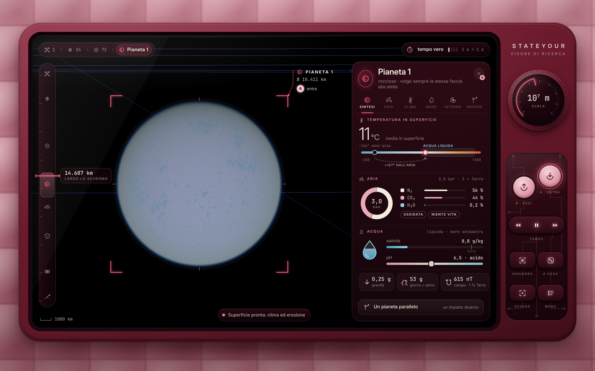
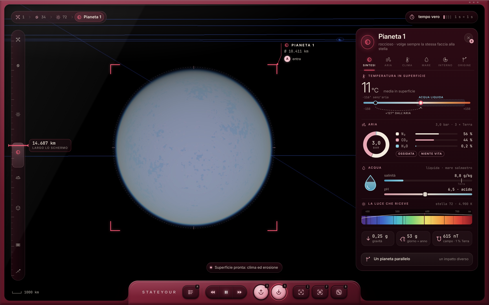

# Il visore — progetto dell'interfaccia

*Nota: il generatore di pattern non fa più parte dell'app, che ora finisce alla scala quantistica; è un progetto a parte in `pattern/` ([pattern/LEGGIMI.md](pattern/LEGGIMI.md)). Nel visore non ci sono più la scheda del pattern (Sezione, Leggi), la cella, il seme da file né la biblioteca: le righe di questo progetto che ne parlano restano come storia.*

*Prototipo visivo: `prove/visore/visore.html` (`?v=A` palmare, `?v=B` schermo pieno). Schermate: `prove/visore/visore_A.png`, `visore_B.png`. La finestra 3D al centro è uno scatto vero dell'app (il pianeta 1 della stella 72).*

## 1. L'idea

Uno strumento, non una pagina. È il **visore di un ricercatore**: un palmare bordeaux soft-touch con un vetro grande e scuro, una ghiera per la scala e pochi tasti retroilluminati. Come il Game Boy di Artismi con Porto Vecchio: **sullo schermo c'è solo l'universo**; i comandi sono tasti veri; tutto il resto sta nelle schede e nel menu.

Lo schermo risponde sempre a quattro domande, e a nient'altro:

| domanda | risposta sullo schermo | dove |
|---|---|---|
| **Dove sono?** | la catena dell'indirizzo, fatta di icone | in alto a sinistra |
| **Quanto è grande?** | l'altimetro della scala, logaritmico | lungo il bordo sinistro |
| **Che cosa guardo?** | il mirino sul bersaglio, con nome e misura | sul bersaglio |
| **Quando?** | il tempo | in alto a destra |

Tutto il resto (perché è così, di che cosa è fatto, come poteva andare) si apre **a richiesta**, in una scheda.

## 2. La gerarchia visiva

1. **La finestra**: sempre più dell'80% dell'area. Nella variante B la finestra occupa il 95% del monitor e l'HUD fisso ne copre il 4%; con la scheda aperta resta libero il 70%, e la camera sposta il bersaglio al centro della parte libera (nel prototipo il pianeta sta a sinistra della scheda). Nel palmare (A) lo schermo è il 76% della faccia del dispositivo.
2. **I dati vitali**: i quattro della tabella sopra, piccoli, in vetro scuro, ai bordi. Non hanno frasi, solo icone e cifre.
3. **Su richiesta**: la scheda del bersaglio (a destra), il menu (≡), il taccuino (i testi lunghi).
4. **Un solo avviso alla volta**, in basso al centro, che sparisce da solo («Superficie pronta: clima ed erosione»).

## 3. Le zone

**Schermo** (uguale in A e B; margine `--m` di 18–22 px; vetro scuro tinto bordeaux con `backdrop-filter`):
- **In alto a sinistra: la catena.** `◌ 1 › ◎ 34 › ✳ 72 › ● Pianeta 1`. Ogni anello è un'icona di livello con il suo numero e porta su a quel livello. L'ultimo anello è l'unico con il nome per intero e con l'accento.
- **In alto a destra: il tempo.** L'icona, «tempo vero», quattro tacche per la velocità e il rapporto (`1 s = 1 s`). Con un clic si apre il passo del tempo (oggi `≈`) e la fetta.
- **Lungo il bordo sinistro: l'altimetro della scala.** In alto c'è il cosmo (10²⁶ m), in basso le particelle (10⁻¹⁵ m). Ha una tacca per decade e le otto icone dei livelli al loro posto. L'**ago** con l'accento segna la larghezza dello schermo (`14.687 km`); una **banda rosa** va da un pixel alla larghezza dello schermo, cioè le grandezze che si vedono adesso. In basso, la barra lineare (`1000 km`). Trascinare l'ago fa lo zoom e un clic su un'icona vola a quel livello.
- **Sul bersaglio: il mirino.** Quattro angoli con l'accento, un giro tratteggiato e le tacche cardinali. Una linea guida porta all'etichetta: il nome, Ø, e il tasto che fa la cosa più probabile (**Ⓐ entra**).
- **In basso al centro: l'avviso**, uno alla volta.
- **A destra: la scheda**, quando è aperta.

**Cornice A — il palmare** (colonna destra, per il pollice destro):
- il marchio `STATEYOUR · visore di ricerca`, inciso;
- la **ghiera della scala**: zigrinata, con un quadrante di vetro (un arco di 270° dal cosmo all'ago, e `10⁷ m`). È la rotella del mouse resa fisica;
- la **pulsantiera trasparente**: vetro fumé con il circuito visibile, e sette tasti in tutto: **A entra** (l'unico con l'anello di luce, perché è l'azione suggerita) e **B esci**, il **bilanciere del tempo** (◀◀ ❚❚ ▶▶), **inquadra** e **a caso**, **scheda** e **menu**. Sotto ogni tasto c'è una scritta incisa.

**Cornice B — schermo pieno** (Electron senza bordi):
- una cornice di 14 px nello stesso materiale; il bordo alto serve a trascinare la finestra, con tre punti per chiudere, ridurre e ingrandire;
- in basso al centro una **linguetta** che sale dalla cornice e porta gli stessi tasti in fila, ognuno con la lettera della tastiera: `M` menu · `◀◀ ❚❚ ▶▶` (`,` `p` `.`) · `B` esci · `A` entra · `I` scheda · `F` inquadra · `R` a caso. La ghiera qui è la rotella del mouse; il suo quadrante è l'altimetro.

## 4. Le icone (20)

Un solo tratto (1,6 su una griglia di 24), angoli tondi, nessun riempimento salvo un punto. Avorio a riposo, accento quando indicano «qui».

| gruppo | icona | significato |
|---|---|---|
| **livelli (8)** | cosmo | la rete delle galassie: nodi e fili |
| | galassia | due bracci a spirale |
| | stella | un disco con otto raggi |
| | pianeta | una sfera con meridiano e paralleli |
| | terreno | rilievo e orizzonte: regioni, continenti, fiumi |
| | materia | un cristallo esagonale: rocce, grani, cristalli |
| | atomo | il nucleo e due orbite: molecole, atomi |
| | particella | una traccia con un ginocchio: particelle, decadimenti |
| **azioni (6)** | mirino | il bersaglio: apre la sua scheda |
| | entra | una freccia che scende nella conca: verso ciò che sta sotto |
| | esci | una freccia che sale dalla conca: un livello su |
| | tempo | un orologio: velocità, passo, fetta |
| | inquadra | una cornice con una scintilla: «una finestra bella a questa scala» |
| | a caso | il dado: un punto a caso dell'universo |
| **schede (5)** | aria | le volute del vento: composizione, pressione, i mattoni della vita |
| | clima | il termometro: temperature, ghiaccio, stagioni, la mappa |
| | acqua | la goccia: mare, laghi, sale, pH, la pozza |
| | interno | la sfera tagliata: nucleo, dinamo, calore, placche |
| | ramo | un tronco che si divide: l'origine (perché è così) e il mondo parallelo |
| **sistema (1)** | menu | tre punti e tre righe |

Glifi universali che non contano come icone: × chiudi, › catena, ◀◀ ❚❚ ▶▶.

## 5. Menu e schede

**La scheda** del bersaglio. Si apre con il tasto **scheda** (`I`), con un clic sull'etichetta del mirino o con un clic su un anello della catena. Si chiude con **B**, `Esc` o ×. Ce n'è **una sola** aperta per volta, ancorata a destra, larga 372–400 px. In alto ha lo stemma del livello, il nome, una riga di identità («roccioso · volge sempre la stessa faccia alla stella») e le linguette fatte di icone. Per il pianeta le linguette sono:

- **Sintesi**: la temperatura, l'aria, l'acqua, tre tessere (gravità, giorno, campo) e un'azione (*un pianeta parallelo*). Si legge in tre secondi.
- **Aria**: l'anello della composizione grande; la pressione su una scala rispetto alla Terra; *i mattoni della vita* come resa (un indicatore da «niente» a «molto»); *che cosa fanno qui le particelle* come barre impilate (UV, fulmini, aurore, raggi cosmici) e la dose come termometro dell'esposizione.
- **Clima**: la mappa del pianeta (l'immagine che c'è già); la terra tra luce e ombra se è bloccato dalle maree; l'asse inclinato con le stagioni; il ghiaccio in percentuale.
- **Mare**: salinità, pH e ioni come barre in moli/kg; i laghi e le sorgenti calde come conteggi con icona; la pozza di Bénard come immagine, con il regime (esagoni o rulli) come etichetta.
- **Interno**: lo spaccato del pianeta in scala (nucleo al 47% del raggio, liquido o solido), le linee del campo se c'è la dinamo, il flusso di calore, le placche o il guscio.
- **Origine**: *perché è fatto così* come catena verticale di icone (inizio → galassia → generazioni di stelle → disco → pianeta), un numero per ogni passo; *da dove viene ciò che vedi* come conteggi con icone (5 × getto, 9 × fondo, 1 × supernova); *il pianeta parallelo* come ramo.

Le altre schede hanno la stessa struttura. La **stella** ha lo spettro (colore, curva del corpo nero, righe di assorbimento: nel prototipo B è «la luce che riceve»), la temperatura come colore, massa ed età, e la posizione su un piccolo diagramma H-R. La **galassia** ha la forma, la storia delle stelle in una curva e i getti. Il **cosmo** ha la mappa delle densità. Il **pattern** (la cella) ha le cinque leggi come interruttori con icona, le sorgenti, le specie e la lastra.

**Il menu** (≡, `M`). Si apre un cassetto da sinistra, largo al massimo il 30%; la scena si scurisce ma continua a muoversi. Si chiude con B, `Esc` o un clic fuori. Ha cinque voci, ognuna con icona:
1. **Seme**: nuovo (la biblioteca a carte, con immagini), apri un'immagine, apri e salva il seme, esporta l'immagine, il seme come testo, annulla e rifai.
2. **Vista**: osserva (3D), la finestra, il piano; la mappa piatta.
3. **Taccuino**: tutti i testi lunghi, impaginati per leggere (la guida ai comandi, «l'universo intero, da esplorare…», le spiegazioni delle schede).
4. **Impostazioni**: qualità, adattamento dell'occhio, unità di misura.
5. **Diagnostica**: linee, punti, ms, fps.

**Il taccuino** è la regola dei testi: nessuna frase oltre una riga nelle schede. Ogni sezione ha un `›` che apre la sua spiegazione nel taccuino.

## 6. I contenuti diventano grafica

| dato (oggi è testo) | grafica |
|---|---|
| «11 °C … (−116 °C senza atmosfera)» | il **termometro** da −150 a +150: il colore va dal freddo al caldo; la banda tratteggiata è l'acqua liquida (alla pressione del pianeta); un anello vuoto a −116° «senz'aria»; un arco «+127° dall'aria» fino al punto pieno a 11°. Il numero grande sta sopra. |
| «L'aria: N2 56%, CO2 44%, H2O 0.2%», «3.0 bar» | l'**anello** della composizione con la pressione al centro; una legenda con barre; le etichette `ossidata`, `niente vita` |
| «acqua liquida», «salinità 8.8 g/kg, pH 6.5» | la **goccia** riempita fino al livello; la **salinità** come barra con la tacca della Terra; il **pH** come scala da acido a basico con il cursore |
| «gravità 2.5 m/s²», «il giorno dura quanto l'anno, 53 giorni», «615 nT» | tre **tessere**, ognuna con icona, cifra e una parola |
| «lo schermo è largo 14.687 km» | l'**altimetro logaritmico** con l'ago e la banda del visibile |
| «il cosmo 1 › la galassia 34 › …» | la **catena di icone** |
| il bersaglio («un pianeta: un volume largo 10.411 km») | il **mirino** con l'etichetta |
| la stella (temperatura, luce) | lo **spettro**: arcobaleno, curva del corpo nero, righe |
| «perché è fatto così» (cinque paragrafi) | la **catena delle cause** con icone e un numero per passo |
| «5 × il getto del buco nero…» | **conteggi** con icona |
| il tempo («tempo vero») | l'**orologio** e le tacche della velocità |

## 7. I colori (la palette di Artismi)

| ruolo | colore |
|---|---|
| la scocca, la plastica soft-touch | bordeaux `#6b1a2c` (dal `#82243a` in luce al `#3d0d18` in ombra) |
| i tasti tondi, le scritte incise, le piastrelle del fondo | rosa `#e9a9b6` / `#f2c4cd` / `#f8dfe3` |
| il testo e i numeri sullo schermo | avorio `#f4ecdf` (a 72%, 52%, 30%, 14% per i livelli) |
| **l'accento luminoso** | rosa fosforo `#ff5a78` con il bagliore. **Significa una cosa sola, «qui»**: il bersaglio, il livello dove sei, la linguetta aperta, il tasto suggerito |
| i colori dei dati (solo nei grafici) | freddo `#8ecfe0` (acqua, ghiaccio), caldo `#f2a65a` (calore) |
| i vetri dell'HUD | bordeaux quasi nero, trasparente al 55–80%, sfocato |

## 8. La tipografia

- **Inter Display** per i titoli e i numeri grandi: `Pianeta 1` (22), `11 °C` (46, leggero).
- **Inter** per le etichette: le intestazioni in maiuscolo spaziato (9,5, +0,2 em), le righe di testo (12).
- **JetBrains Mono** per le misure e le cifre (11–14), con le cifre a larghezza fissa, perché i numeri che cambiano non devono ballare.
- Il marchio è in Inter Display spaziato +0,46 em, come il logo «ARTISMI».

## 9. Le regole di ergonomia cognitiva

1. **Una sola cosa in evidenza.** L'accento va soltanto su ciò che è «qui» (il bersaglio e la sua catena, l'ago, la linguetta, il tasto A); tutto il resto è avorio attenuato.
2. **Raggruppare per domanda.** Dove, quanto, quando e che cosa hanno ciascuno il proprio angolo, sempre lo stesso a ogni scala: l'occhio impara il posto una volta.
3. **Un dato, una forma.** Ogni grandezza ha la sua grafica, e la stessa grandezza ha la stessa grafica in ogni scheda (la temperatura è sempre un termometro).
4. **Ritmo.** Una griglia di 8 px; nelle schede un'intestazione, poi una grafica, poi al massimo una riga; sezioni separate da un filo.
5. **Contrasto per gerarchia.** Il numero grande, l'etichetta piccola in maiuscolo; il valore in avorio pieno, il contesto al 50%.
6. **Niente frasi sullo schermo.** Il testo lungo va nel taccuino; i suggerimenti sono tasti (`Ⓐ entra`), non istruzioni.
7. **Un avviso alla volta**, che sparisce da solo.
8. **La scena non si copre per caso.** Si apre una sola cosa per volta (la scheda o il menu); la camera fa spazio al bersaglio.

## 10. Schermi larghi e stretti

- **Electron a tutto schermo (≥ 1280 px):** la variante B. La scheda è ancorata a destra (400 px), la linguetta sta in basso al centro e l'altimetro è intero.
- **Finestra media (900–1280 px):** la scheda scende a 340 px e mostra solo icone nelle linguette; la linguetta perde il marchio; l'altimetro mostra le icone solo per i livelli vicini.
- **Stretto o verticale (< 700 px, telefono):** la finestra va a tutto schermo. La catena si riduce al livello attuale con `‹`; l'altimetro diventa una striscia sottile a sinistra; la scheda diventa un **cassetto dal basso** (40% dell'altezza, si tira su per vederla intera, con le linguette in una fila sola che entra sempre); i tasti diventano una fila di cinque (B, A, tempo, scheda, menu), mentre inquadra e a caso vanno nel menu.
- **Il palmare (A)** è la stessa interfaccia con una cornice più spessa. Va bene per tablet orizzontali, per la presentazione o per una finestra non a schermo pieno.

## 11. Dove va ogni elemento di oggi

| oggi (`index.html`, `laboratorio.js`) | nel visore |
|---|---|
| titolo `stateyour` nella barra in alto | **sparisce**: diventa il marchio inciso sulla cornice |
| menu **File** (nuovo, immagine, apri/salva seme, png, seme come testo) | menu ≡ › **Seme** |
| ↶ ↷ annulla, rifai | `Ctrl+Z/Y`, e la voce in menu › Seme |
| barra del mondo: ◀◀ ❚❚ ▶▶ e «tempo vero» | **bilanciere del tempo** (tasti) + il chip del tempo in alto a destra |
| `≈` il passo del tempo | si apre con un clic sul chip del tempo; di base è automatico |
| `▦ mappa piatta` | menu › Vista, e la linguetta Clima della scheda |
| barra di scala «1000 km · lo schermo è largo 14.687 km · un pianeta» | **altimetro** (larghezza dello schermo e livello) + barra lineare `1000 km` |
| 🎲 un punto a caso | il tasto **a caso** (`R`) |
| il cosmo · la finestra · l'universo/piano | menu › **Vista** (e il fondo dell'altimetro porta al pattern) |
| `#dove` (indirizzo + «sopra 14.32° N… l'occhio è adattato… Trascina: gira…») | l'indirizzo va nella **catena**; la quota nell'etichetta del mirino; l'adattamento dell'occhio nelle impostazioni; le istruzioni nel **taccuino** (Guida) e nella prima apertura. **La riga sparisce.** |
| `#misure` (linee, punti, ms) | menu › **Diagnostica**. **Sparisce dallo schermo.** |
| `#errore` | l'avviso in basso (rosso), uno alla volta |
| pannello «← la regione», «dove si trova» | **esci** (B) e la catena |
| la catena «cosmo 1 › galassia 34 › …» nel pannello | **sparisce**: è un doppione della catena dell'HUD |
| 🎲 una finestra bella a questa scala + la nota | il tasto **inquadra** (`F`); la nota nel taccuino |
| il riquadro «L'universo intero, da esplorare…» | taccuino › Guida (si vede alla prima apertura). **Sparisce dal pannello.** |
| IL PIANETA (temperatura, pressione, gravità, acqua, trattiene) | scheda › **Sintesi** (termometro, anello, goccia, tessere) |
| ✦ un pianeta parallelo + la spiegazione | l'azione in fondo alla Sintesi; la spiegazione in Origine |
| L'ARIA E I MATTONI DELLA VITA | scheda › **Aria** |
| CHE COSA FANNO QUI LE PARTICELLE | scheda › **Aria** (barre dell'energia, dose) |
| PERCHÉ È FATTO COSÌ | scheda › **Origine** (catena delle cause) |
| L'INTERNO | scheda › **Interno** (spaccato) |
| IL CLIMA, LA SUPERFICIE (la mappa) | scheda › **Clima** |
| IL MARE, LA SUPERFICIE: UNA POZZA | scheda › **Mare** |
| DA DOVE VIENE CIÒ CHE VEDI | scheda › **Origine** (conteggi con icone) |
| (piano e cella) forze come chip, «solo», ⏻, spiegaForza | scheda del pattern › **Leggi**: cinque interruttori con icona; la spiegazione in una riga |
| (cella) «aggiungi»: particella, campo, materia, massa | un **vassoio di strumenti** che appare solo nella cella, sul bordo sinistro sotto l'altimetro |
| (piano) cursori del tempo e della fetta, ▶ gioca, scatti | il **bilanciere** + il chip del tempo che si allarga in una pista con gli scatti come tacche |
| (piano) universo n., cerca, «da dove la guardi», «chi guarda», piastrella, elementi | scheda del pattern › linguette Sezione, Osservatore, Piastrella, Elementi |
| finestra «Da dove partiamo?» (carte) | menu › Seme › **Biblioteca**: carte con immagine |
| finestra «Leggo l'immagine» (quattro passi) | un **anello in quattro spicchi** al centro dello schermo, con il nome del passo |
| finestra «Il seme» (textarea) | il taccuino, in modo testo |

**Che cosa sparisce del tutto:** la barra in alto, la riga di stato in basso, le istruzioni sempre visibili, i paragrafi introduttivi ripetuti, la seconda catena nel pannello, le cifre di diagnostica sullo schermo, le emoji nei bottoni (diventano le icone del sistema).

## 12. Note per realizzarlo

- I colori, i vetri e i materiali stanno nelle variabili CSS del prototipo (`--bordeaux-*`, `--rosa-*`, `--avorio`, `--accento`) e si possono riusare così come sono. Le icone sono un unico sprite SVG di `<symbol>`.
- La scheda e l'HUD sono HTML sopra la tela; la camera deve conoscere il riquadro libero, cioè la tela meno la scheda, per centrare il bersaglio.
- Mentre facevo lo scatto ho notato una cosa nell'app. Nascondendo il pannello laterale prima che la scena 3D partisse, la tela si è allargata a 1280 × 790 ma il buffer è rimasto a 1840 × 1338 (rapporto 1,38 invece di 1,62), e il pianeta è uscito schiacciato. Per il prototipo ho corretto l'immagine. Quando la scheda si apre e si chiude, o a schermo pieno, il rapporto della camera va ricalcolato.
